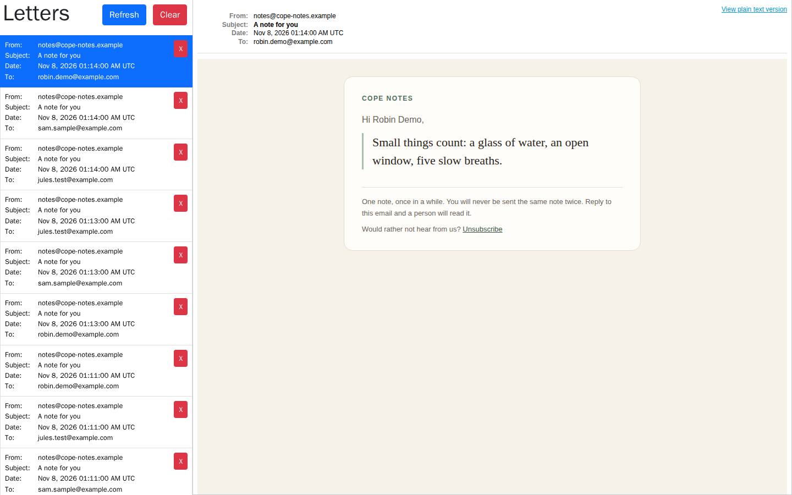
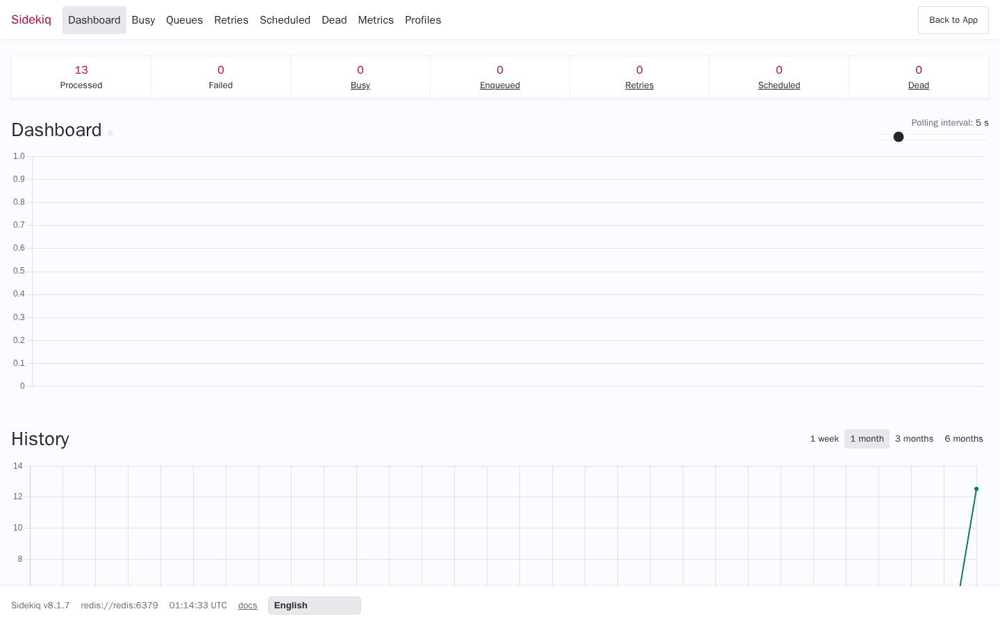

# Captured output

Everything on this page was produced on 2026-11-08 by the stack in
`docker-compose.yml` (Ruby 3.4.12, Rails 8.1.4, Sidekiq 8.1.7, PostgreSQL 16,
Redis 7), against the seed data in `db/seeds.rb`. Nothing here is illustrative
or reconstructed; the only edits are trimmed log prefixes and unsubscribe tokens
replaced with `<token>`. The stack ran under the compose project name
`p2-cope-notes`, which is why the container names carry that prefix.

## 1. One command, four containers

```console
$ docker compose up --build -d
$ docker compose ps
p2-cope-notes-db-1       Up 7 minutes (healthy)
p2-cope-notes-redis-1    Up 7 minutes (healthy)
p2-cope-notes-web-1      Up About a minute (healthy)
p2-cope-notes-worker-1   Up About a minute (healthy)
```

The web container owns the schema; the worker waits for it to report healthy and
only then starts the Sidekiq process that carries the schedule.

```console
$ docker compose logs web
==> rails db:prepare
==> rails db:seed
Seeded: 10 notes, 4 subscribers (3 active)
* Puma version: 8.0.2 ("Into the Arena")
* Ruby version: ruby 3.4.12 (2026-10-23 revision 366f5fdc00) +PRISM [aarch64-linux]
* Listening on http://0.0.0.0:3000
```

## 2. The pipeline running

The scheduler fires `DispatchDeliveriesJob` once a minute. It enqueues one
`DeliverNoteJob` per due subscriber, and those run in parallel across the
Sidekiq thread pool: three subscribers, three threads, three sends inside
40 ms of each other.

```console
$ docker compose logs worker
Scheduling dispatch_deliveries {"cron" => "0 * * * * *", "class" => "DispatchDeliveriesJob", "queue" => "default"}
Schedules Loaded
01:11:00.304Z class=DispatchDeliveriesJob: [deliveries] dispatched 3 subscriber(s)
01:11:00.558Z class=DeliverNoteJob: Delivered mail 6aefcc24810ee_114c843215@6f73d0697536.mail (34.5ms)
01:11:00.559Z class=DeliverNoteJob: Delivered mail 6aefcc248112f_114d0433e7@6f73d0697536.mail (35.0ms)
01:11:00.559Z class=DeliverNoteJob: Delivered mail 6aefcc248119c_114c0434c5@6f73d0697536.mail (34.7ms)
```

`Schedules Loaded` must be preceded by a `Scheduling dispatch_deliveries` line.
If it says `Schedule empty!` instead, sidekiq-scheduler did not find the
schedule in `config/sidekiq.yml` and nothing will ever be sent;
`spec/config/sidekiq_schedule_spec.rb` exists to catch exactly that.

## 3. A note actually being delivered



Mail sent in development is captured by letter_opener and served at
`/letter_opener`. Each note above is a real send by the Sidekiq worker, chosen
at random from the notes that subscriber had not yet received. The plain-text
part of the same kind of email:

```text
COPE NOTES

Hi Ash Demo,

A hard day is not the same as a hard life. This one will pass too.

--
One note, once in a while. You will never be sent the same note twice.
Reply to this email and a person will read it.

Unsubscribe: http://localhost:8191/unsubscribe/<token>
```



**If the worker is not running, nothing is ever emailed** - the schedule lives
in the Sidekiq process, not in the web process.

## 4. Screening a note as it is written

Note text is screened before it is stored. With no `ANTHROPIC_API_KEY` set - as
here - the offline keyword reviewer answers, and the API still returns `201`
with the verdict recorded on the note. Bodies may be flat or wrapped in
`message`.

```console
$ curl -i -X POST http://localhost:8191/api/v1/messages -H 'Content-Type: application/json' \
       -d '{"text":"Slow mornings are allowed. Start wherever you are."}'
HTTP/1.1 201 Created
{"id":11,"text":"Slow mornings are allowed. Start wherever you are.","review_status":"approved","deliveries_count":0,"subscribers":[]}
```

Unkind rather than dangerous is **flagged**: still deliverable, but an editor
should see it.

```console
$ curl -X POST http://localhost:8191/api/v1/messages -H 'Content-Type: application/json' \
       -d '{"text":"Just get over it, others have it worse."}'
{"id":12,"text":"Just get over it, others have it worse.","review_status":"flagged","deliveries_count":0,"subscribers":[]}
```

Medication advice is **rejected**, and the delivery path will never select it.

```console
$ curl -X POST http://localhost:8191/api/v1/messages -H 'Content-Type: application/json' \
       -d '{"message":{"text":"Skip your meds for a week and see how you feel."}}'
{"id":13,"text":"Skip your meds for a week and see how you feel.","review_status":"rejected","deliveries_count":0,"subscribers":[]}
```

An editor's queue, and what a bad write looks like:

```console
$ curl 'http://localhost:8191/api/v1/messages?review_status=flagged'
[{"id":12,"text":"Just get over it, others have it worse.","review_status":"flagged","deliveries_count":0,"subscribers":[]}]

$ curl -i -X POST http://localhost:8191/api/v1/messages -H 'Content-Type: application/json' -d '{"text":""}'
HTTP/1.1 422 Unprocessable Content
{"text":["can't be blank"]}
```

## 5. Subscribers

Addresses are trimmed and lower-cased on the way in, so two spellings of one
address cannot both subscribe:

```console
$ curl -i -X POST http://localhost:8191/api/v1/subscribers -H 'Content-Type: application/json' \
       -d '{"email":"  Ash.Demo@Example.com ","name":"Ash Demo"}'
HTTP/1.1 201 Created
{"id":5,"name":"Ash Demo","email":"ash.demo@example.com","is_active":true,"last_delivered_at":null,"messages":[]}

$ curl -i -X POST http://localhost:8191/api/v1/subscribers -H 'Content-Type: application/json' \
       -d '{"email":"ash.demo@example.com","name":"Ash Again"}'
HTTP/1.1 422 Unprocessable Content
{"email":["has already been taken"]}
```

## 6. Unsubscribing in one click

This is the request a mail client sends when the reader presses its own
"Unsubscribe" button (RFC 8058). It needs no session and no CSRF token; the
token in the URL is the credential.

```console
$ curl -i -X POST http://localhost:8191/unsubscribe/<token> -d 'List-Unsubscribe=One-Click'
HTTP/1.1 200 OK
...<h1 role="status">You are unsubscribed</h1>...

$ curl http://localhost:8191/api/v1/subscribers/5
{"id":5,"name":"Ash Demo","email":"ash.demo@example.com","is_active":false,"last_delivered_at":"2026-11-08T01:14:49.763Z","messages":[{"id":3,"text":"A hard day is not the same as a hard life. This one will pass too.","review_status":"approved","deliveries_count":2}]}
```

Opening the link in a browser (a GET) only asks for confirmation; see the
screenshots in the README.

## 7. Dispatching twice does not send twice

```console
$ docker compose exec web bin/rails deliveries:tick
Enqueued 1 delivery job(s). They run in the Sidekiq process.
$ docker compose exec web bin/rails deliveries:tick     # straight away, again
Enqueued 0 delivery job(s). They run in the Sidekiq process.
```

The second tick, a moment later, found nobody due: the first had already
consumed the interval. If two ticks ever do overlap, `Subscriber.claim_delivery_slot`
is a single conditional `UPDATE`, so only one of them is told to send.

## 8. Operational snapshot

```console
$ curl http://localhost:8191/api/v1/deliveries/stats
{
    "generated_at": "2026-11-08T01:14:48.810Z",
    "channel": "email",
    "selection_strategy": "random_unsent",
    "interval_minutes": 1,
    "subscribers": { "total": 5, "active": 4, "due_now": 1, "exhausted": 0 },
    "notes": {
        "total": 13,
        "deliverable": 12,
        "by_review_status": { "flagged": 1, "approved": 11, "rejected": 1 }
    },
    "deliveries": { "total": 9, "by_status": { "delivered": 9 }, "last_24h": 9 }
}
```

Every figure is a database aggregate. The endpoint costs the same with ten
deliveries or ten million.

## 9. The scalability measurement

`rails "deliveries:benchmark[10000,200,60]"`, run in the test environment of the
web container against the same Postgres: 10,000 subscribers, 200 notes, 600,000
existing delivery rows. Wall-clock came off a laptop running other containers;
the ratios and the allocation counts are the signal.

```console
$ docker compose exec -e RAILS_ENV=test web bin/rails "deliveries:benchmark[10000,200,60]"
seeding 10000 subscribers, 200 notes, 600000 delivery rows
seeded

--- one tick's work for a page of 1000 subscribers ---
  previous: whole-pool hash + includes(:messages) + set subtraction    941.7 ms     1,172,262 objects
  current:  keyset page of ids + one anti-join query per subscriber    473.5 ms       264,334 objects

--- the two halves of that, separately ---
  previous: Subscriber.active.includes(:messages), one page         798.3 ms     1,124,065 objects
  current:  Subscriber.due, one keyset page of ids                    1.8 ms         1,263 objects

--- extrapolated to 10000 subscribers ---
  selection: 0.47 ms per subscriber, 4.7 s of database time per tick
  sending:   at 150 ms per SMTP round trip, one thread needs 1500 s per tick; 25 Sidekiq threads need 60 s

--- query plan for the selection query ---
  Limit  (actual time=0.115..0.116 rows=1 loops=1)
    Buffers: shared hit=12
    ->  Sort  (actual time=0.115..0.116 rows=1 loops=1)
          Sort Key: (random())
          Sort Method: top-N heapsort  Memory: 25kB
          ->  Hash Right Anti Join  (actual time=0.071..0.092 rows=140 loops=1)
                Hash Cond: (se.message_id = messages.id)
                ->  Index Scan using index_subscriber_emails_on_subscriber_id on subscriber_emails se
                      Index Cond: (subscriber_id = 1)
                ->  Hash  (actual time=0.037..0.037 rows=200 loops=1)
                      ->  Seq Scan on messages
                            Filter: ((review_status)::text <> 'rejected'::text)
  Execution Time: 0.135 ms
```

The selection query is an anti-join that touches 12 shared buffers and nothing
on the heap of `subscriber_emails`, however many rows that table holds for other
subscribers.

## 10. The test suite and lint

```console
$ bin/rails db:test:prepare && bundle exec rspec
163 examples, 0 failures

$ bin/lint
76 files inspected, no offenses detected
```
